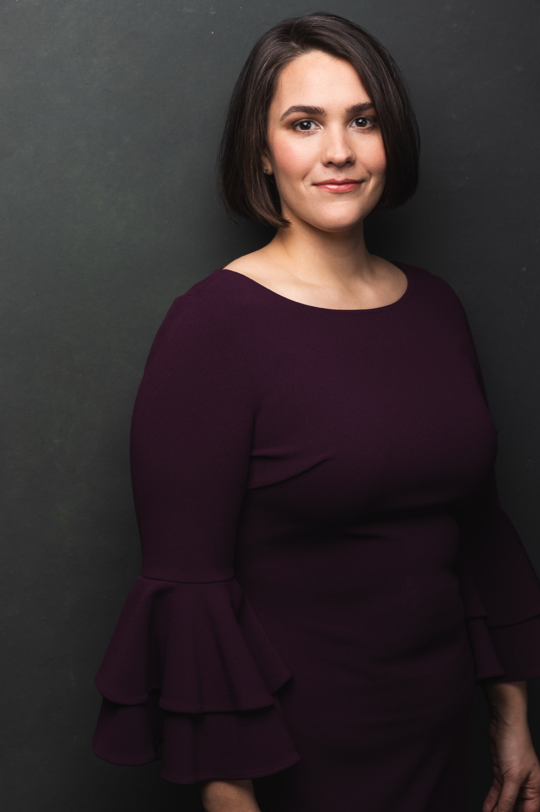
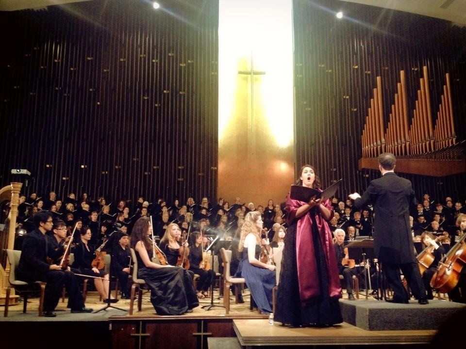
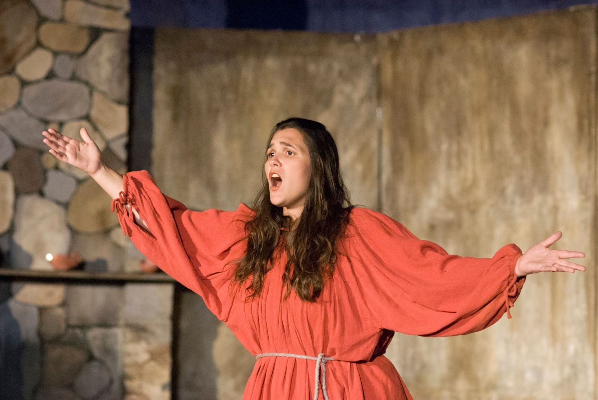
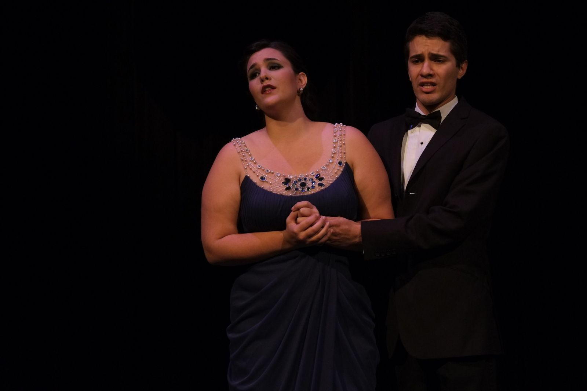
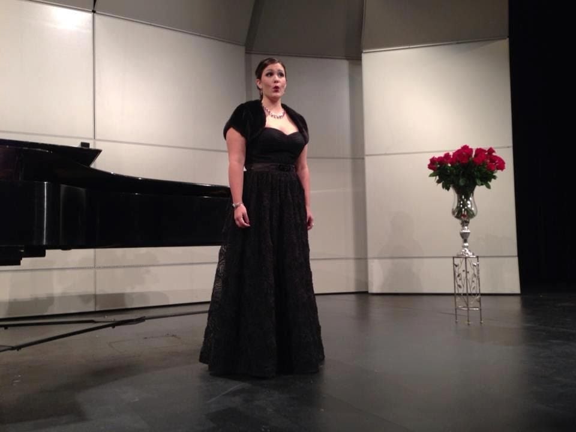
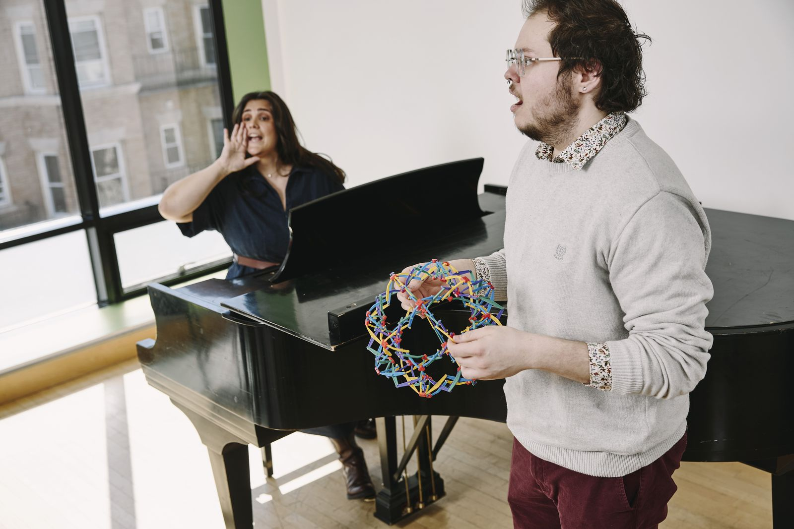

::: {.content-section}

{.portrait fig-alt="Kayla Gautereaux in a plum dress against a dark backdrop"}

I'm a mezzo-soprano, voice teacher, scholar, and program leader. At [Boston Conservatory at Berklee](https://bostonconservatory.berklee.edu/faculty/kayla-gautereaux), where I'm Assistant Professor of Voice and Vocal Pedagogy, I lead the graduate vocal pedagogy area and supervise graduate students' research.

## San Diego

I studied vocal performance at San Diego State University and began teaching voice privately in 2012. While I was still a student, I co-founded the Folklore Guild, a choir that sang video game and film music, and I spent three years as Director of Development and Education for Bach Collegium San Diego. There I helped double the ensemble's annual budget and used grants from the National Endowment for the Arts and the City of San Diego to start open rehearsals and lectures for students in Title I schools. It was my first time building an education program from the ground up.

::: {.singing-gallery}
{fig-alt="Kayla Gautereaux singing as mezzo-soprano soloist with orchestra and choir"}
{.focus-face fig-alt="Kayla Gautereaux as the Mother in Menotti's Amahl and the Night Visitors, singing with arms outstretched"}
{.focus-left fig-alt="Kayla Gautereaux in an opera scene with a tenor"}
{fig-alt="Kayla Gautereaux singing a recital beside a grand piano"}
:::

<!-- TODO: Embed a singing recording here when Kayla picks one. -->

## New England Conservatory

I moved to Boston for a master's degree in vocal pedagogy at New England Conservatory and stayed on in two jobs at once: Assistant Vocal Pedagogy Director on the faculty, and manager of the Voice and Sound Analysis Lab. Since 2019 I have been on the faculty of the Acoustic Vocal Pedagogy Workshop, now run by the Embodied Music Lab, and have helped organize it. When the pandemic moved lessons online, Ian Howell and I ran SoundJack Bootcamp to help musicians rehearse together over the internet and published a comparison of audio quality on the major video-call platforms.

At the same time I worked as a research assistant at the Massachusetts General Hospital (MGH) Voice Center on a study of ambulatory voice monitoring.

## Boston Conservatory at Berklee

Boston Conservatory hired me in 2022 to lead the research side of two graduate degrees in voice teaching and singing, and to help students build their skills in scholarly reading, research, and publication. Since then we have built a voice science lab and a thesis sequence in quantitative and mixed methods with institutional review board (IRB) review for every study. I have also strengthened the conservatory's existing partnership with the MGH Voice Center, which gives incoming voice students a screening and follow-up care. Student theses are collected in a public [research archive](https://research.kaylagautereaux.com).

In 2024 I took on leadership of the whole area, which includes the MM in Vocal Pedagogy and the MFA in Musical Theater Vocal Pedagogy. Alumni of the program have given 35 conference presentations since 2022, 19 of them at the Voice Foundation's annual symposium, and graduates now teach at Oberlin, Brown, Catholic University of America, Oklahoma State, and UMass Amherst. I also direct the Vocal Pedagogy Professional Workshop for working voice teachers. In 2023 the National Association of Teachers of Singing (NATS) gave me its Voice Pedagogy Award.

## How I teach

{.lab-photo fig-alt="Kayla Gautereaux at the piano coaching a singer"}
[Photo: Simon Simard for Berklee]{.photo-credit}

I call my approach scientific method informed voice teaching. In a lesson, I listen and watch, the student tells me what they feel, and we decide together what to try next. We keep what turns out to be observable, measurable, and repeatable. Over time I want students to be able to run these experiments on their own.

I tell my graduate students that research is a form of artistic expression, and that the best questions in voice research come from what teachers notice in their own studios. I talked about all of this on the VocalFri Podcast in 2025:

<iframe title="Scientific Method Informed Voice Teaching, VocalFri Podcast" class="podcast-player" height="150" width="100%" scrolling="no" loading="lazy" src="https://www.podbean.com/player-v2/?i=88x5b-1998280&share=0&download=0"></iframe>

## What I'm building now

In 2024 I started building the AI Supported Voice Studio Portal, which I now use with my private students. After each lesson it produces a debrief and a practice plan, and students use it to track their progress between lessons. In 2026 it won the Pan American Vocology Association's Best Microworkshop/ToolTalk award. [More about the portal](ai-learning.qmd).

I want good voice pedagogy training to be available to teachers who cannot move to a conservatory city or pay conservatory tuition, and most of what I build now is meant for them.

## Presentations and publications

I present regularly at the Voice Foundation Symposium, the Pan American Vocology Association, and the National Association of Teachers of Singing, usually with the graduate students whose research I supervise. Recent work includes:

- Gautereaux, Kayla, with Ian Howell and Cary Lee. "AI and the Voice Studio: Opportunity, Ethics, and Expertise." NATS Chat webinar, October 2026.
- Gautereaux, Kayla. "AI Supported Voice Studio Portal." Pan American Vocology Association Symposium, 2026. Winner, Best Microworkshop/ToolTalk.
- Howell, Ian, and Kayla Gautereaux. "Special Acts of Breathing: Visualizing Respiration with RespTrack." NATS National Conference, July 2026.
- Meikle, Brianna, Kayla Gautereaux, et al. "Performance Anxiety and Co-Regulation in the Vocal Audition." Voice Foundation Symposium, May 2026.

[Full list of presentations and publications →](speaking.qmd#presentations-and-publications)

## Performing

I perform as a soloist and in choirs, and I sang backup for Ellie Goulding's "Still Falling for You" at the 2022 Earthshot Prize Awards in Boston, with the Prince and Princess of Wales in the audience.

::: {.video-embed}
<iframe src="https://www.youtube-nocookie.com/embed/-Iq9usG3mBM?rel=0" title="Ellie Goulding performs Still Falling for You, The Earthshot Prize 2022 (BBC)" allow="encrypted-media; picture-in-picture; fullscreen" referrerpolicy="strict-origin-when-cross-origin" loading="lazy" allowfullscreen></iframe>
:::

[Ellie Goulding, "Still Falling for You," The Earthshot Prize 2022. Video: BBC]{.video-caption}

::: {.two-col}

:::: {}
## Awards

- 2026 Best Microworkshop/ToolTalk, Pan American Vocology Association, for the AI Supported Voice Studio Portal
- 2023 NATS Voice Pedagogy Award, National Association of Teachers of Singing
- 2022 to 2023 Faculty Development Grant for Inclusive Teaching and Learning, Berklee
- 2021 Board of Trustees Award, New England Conservatory
- 2013 Presser Scholar, San Diego State University
::::

:::: {}
## Education

- MM, Vocal Pedagogy, New England Conservatory (2019)
- BM, Vocal Performance, San Diego State University (2014)
::::

:::

:::
