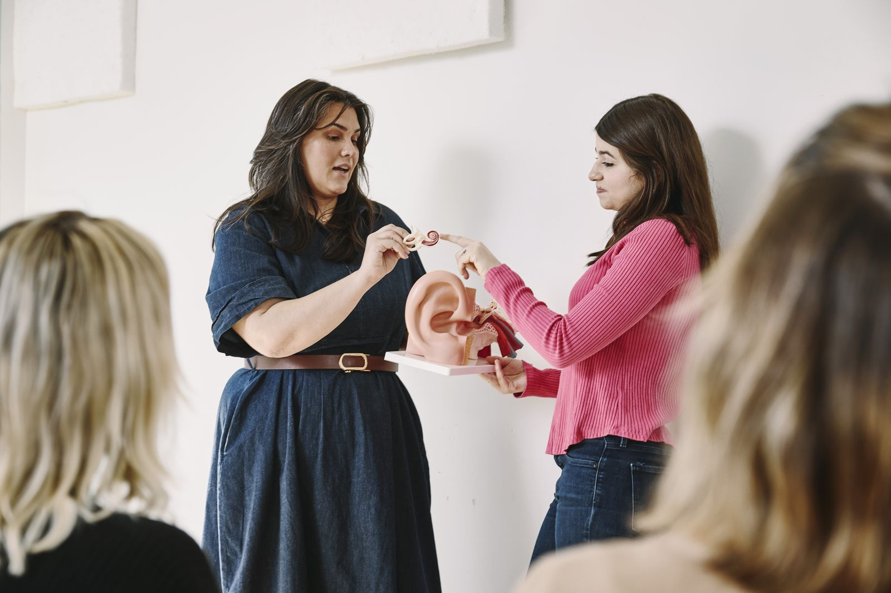
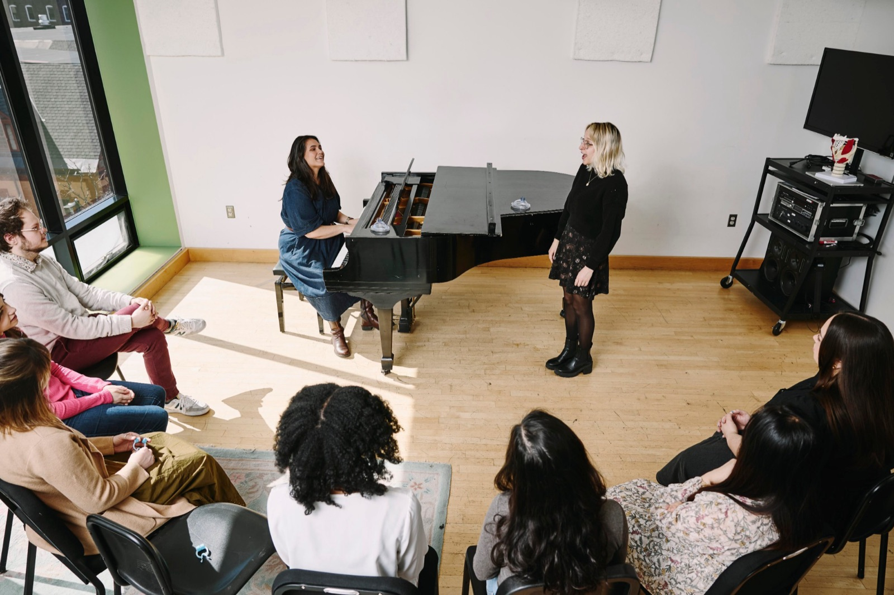
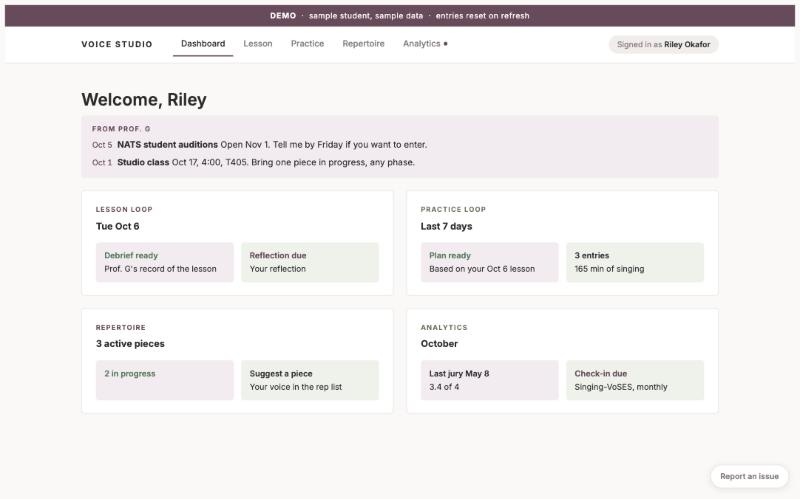

::: {.content-section}

{.portrait fig-alt="Kayla Gautereaux in a plum dress against a dark backdrop"}

I'm a mezzo-soprano, voice teacher, scholar, and program leader. At [Boston Conservatory at Berklee](https://bostonconservatory.berklee.edu/faculty/kayla-gautereaux), where I'm Assistant Professor of Voice and Vocal Pedagogy, I lead the graduate vocal pedagogy area and supervise graduate students' research.

## San Diego

::: {.singing-gallery}
{fig-alt="Kayla Gautereaux singing as mezzo-soprano soloist with orchestra and choir"}
{.focus-face fig-alt="Kayla Gautereaux as the Mother in Menotti's Amahl and the Night Visitors, singing with arms outstretched"}
{.focus-left fig-alt="Kayla Gautereaux in an opera scene with a tenor"}
{fig-alt="Kayla Gautereaux singing a recital beside a grand piano"}
:::

I trained as a singer at San Diego State University, where I studied vocal performance, and I started teaching voice privately in 2012. While I was still a student, I co-founded the Folklore Guild, a choir that sang music from video games and films. I also spent three years as Director of Development and Education for Bach Collegium San Diego, a professional early music ensemble. I helped double its annual budget, and grants from the National Endowment for the Arts and the City of San Diego paid for open rehearsals and lectures for students in Title I schools.

<!-- TODO: Embed a singing recording here when Kayla picks one. -->

## New England Conservatory

I came to Boston for a master's degree in vocal pedagogy at New England Conservatory and stayed on after graduating, as Assistant Vocal Pedagogy Director on the faculty and as manager of the Voice and Sound Analysis Lab. In 2019 I joined the faculty of the Acoustic Vocal Pedagogy Workshop, now run by the Embodied Music Lab. When the pandemic moved lessons online, Ian Howell and I ran SoundJack Bootcamp to help musicians rehearse together over the internet, and we published a comparison of audio quality on the main video-call platforms. During the same years I worked as a research assistant at the Massachusetts General Hospital (MGH) Voice Center on a study of ambulatory voice monitoring.

## Boston Conservatory at Berklee

{.lab-photo fig-alt="Kayla Gautereaux and a student examining an anatomical ear model together"}
[Photo: Simon Simard for Berklee]{.photo-credit}

Boston Conservatory hired me in 2022 to lead the research side of its graduate degrees in voice teaching and singing. My job was to help students learn to read research closely, design studies of their own, and publish what they find. Since then we have built a voice science lab and a thesis sequence in quantitative and mixed methods, with institutional review board (IRB) review for every study. I have also strengthened the conservatory's existing partnership with the MGH Voice Center, which gives incoming voice students a screening and follow-up care. Our students' theses are collected in a public [research archive](https://research.kaylagautereaux.com).

In 2024 I took on leadership of the whole area, including the MM in Vocal Pedagogy and the MFA in Musical Theater Vocal Pedagogy. Since 2022 our alumni have given 35 conference presentations, 19 of them at the Voice Foundation's annual symposium, and graduates now teach at Oberlin, Brown, Catholic University of America, Oklahoma State, and UMass Amherst. I also direct the [Vocal Pedagogy Professional Workshop](https://bostonconservatory.berklee.edu/extension-programs/vocal-pedagogy-professional-workshop), a summer program for working voice teachers, and [Vocal Academy](https://bostonconservatory.berklee.edu/extension-programs/vocal-academy), where adult singers study with our graduate students. In 2023 the National Association of Teachers of Singing (NATS) gave me its Voice Pedagogy Award.

## How I teach

{.lab-photo fig-alt="Kayla Gautereaux at the piano accompanying a student in studio class, with classmates seated in a circle"}
[Photo: Simon Simard for Berklee]{.photo-credit}

I call my approach scientific method informed voice teaching. In a lesson I listen and watch, the student tells me what they feel, and we decide together what to try next. We keep what is observable, measurable, and repeatable, and over time students learn to run these experiments without me. I talked about this approach on the VocalFri Podcast in 2025.

<iframe title="Scientific Method Informed Voice Teaching, VocalFri Podcast" class="podcast-player" height="150" width="100%" scrolling="no" loading="lazy" src="https://www.podbean.com/player-v2/?i=88x5b-1998280&share=0&download=0"></iframe>

I supervise graduate research the same way. Students start from something they have noticed in their own teaching or singing and turn it into a question they can test.

## What I'm building now

{.lab-photo .screenshot-frame fig-alt="The studio portal demo dashboard with sample student data"}

In 2024 I started building the AI Supported Voice Studio Portal for my private students. After each lesson it produces a debrief and a practice plan, and between lessons students use it to log their practice and reflect on how it went. In 2026 it won the Pan American Vocology Association's Best Microworkshop/ToolTalk award. [More about my work with AI](ai-learning.qmd).

I want good voice pedagogy training to be available to teachers who cannot move to a conservatory city or pay conservatory tuition, and most of what I build now is meant for them.

## Presentations and publications

I present regularly at the Voice Foundation Symposium, the Pan American Vocology Association, and the National Association of Teachers of Singing, usually with the graduate students whose research I supervise. Recent work includes:

- Gautereaux, Kayla, with Ian Howell and Cary Lee. "AI and the Voice Studio: Opportunity, Ethics, and Expertise." NATS Chat webinar, October 2026.
- Gautereaux, Kayla. "AI Supported Voice Studio Portal." Pan American Vocology Association Symposium, 2026. Winner, Best Microworkshop/ToolTalk.
- Howell, Ian, and Kayla Gautereaux. "Special Acts of Breathing: Visualizing Respiration with RespTrack." NATS National Conference, July 2026.
- Meikle, Brianna, Kayla Gautereaux, et al. "Performance Anxiety and Co-Regulation in the Vocal Audition." Voice Foundation Symposium, May 2026.

[Full list of presentations and publications →](speaking.qmd#presentations-and-publications)

## Performing

::: {.video-embed}
<iframe src="https://www.youtube-nocookie.com/embed/-Iq9usG3mBM?rel=0" title="Ellie Goulding performs Still Falling for You, The Earthshot Prize 2022 (BBC)" allow="encrypted-media; picture-in-picture; fullscreen" referrerpolicy="strict-origin-when-cross-origin" loading="lazy" allowfullscreen></iframe>
:::

[Ellie Goulding, "Still Falling for You," The Earthshot Prize 2022. Video: BBC]{.video-caption}

I perform as a soloist and in choirs. In 2022 I sang backup for Ellie Goulding's "Still Falling for You" at the Earthshot Prize Awards in Boston, with the Prince and Princess of Wales in the audience.

::: {.two-col}

:::: {}
## Awards

- 2026 Best Microworkshop/ToolTalk, Pan American Vocology Association, for the AI Supported Voice Studio Portal
- 2023 NATS Voice Pedagogy Award, National Association of Teachers of Singing
- 2022 to 2023 Faculty Development Grant for Inclusive Teaching and Learning, Berklee
- 2021 Board of Trustees Award, New England Conservatory
- 2013 Presser Scholar, San Diego State University
::::

:::: {}
## Education

- MM, Vocal Pedagogy, New England Conservatory (2019)
- BM, Vocal Performance, San Diego State University (2014)
::::

:::

:::
