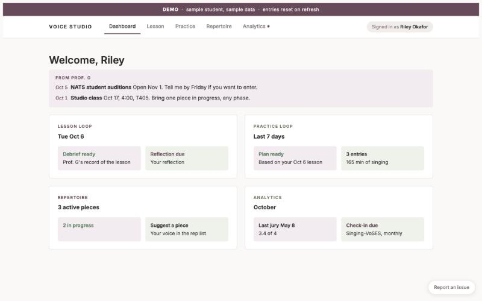
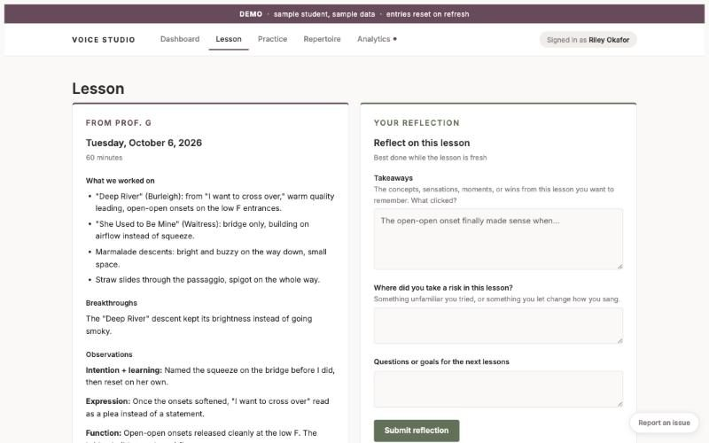
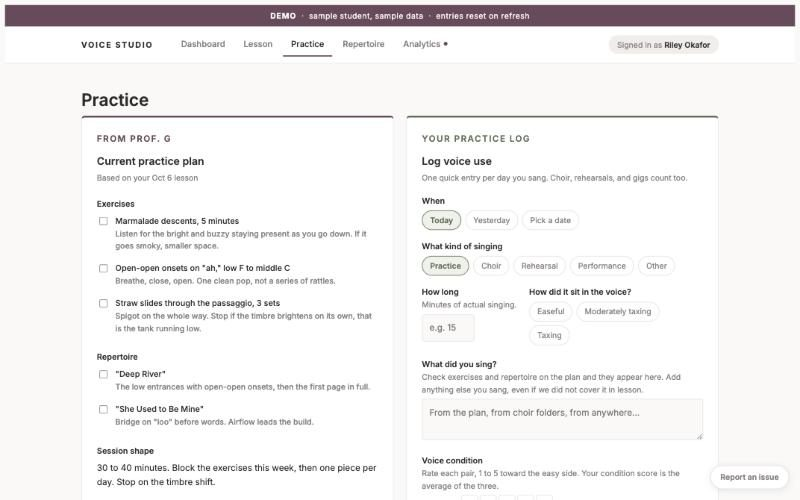
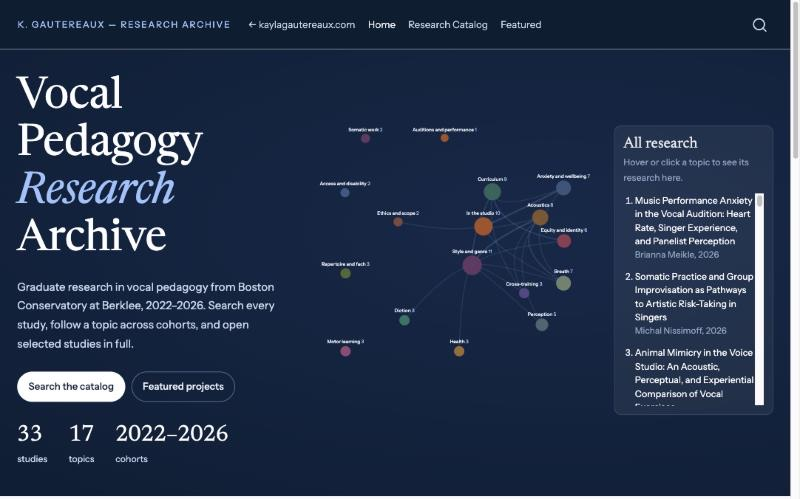

::: {.content-section}

I use AI as a partner in teaching and learning, not as a replacement for either. The teacher still runs the lesson, and the student still does the work of learning. AI can help keep a record of the lesson, prepare for the next one, and give students structure for the practice they do on their own, when no teacher is in the room.

## The AI Supported Voice Studio Portal

I started building this portal in 2024 for my own voice students. I now use it with all of my private students, and in 2026 it won the Pan American Vocology Association's Best Microworkshop/ToolTalk award.

[Try the demo](https://studio.kaylagautereaux.com/demo){.cta-button}
[Visit the studio portal](https://studio.kaylagautereaux.com){.cta-button .outline}

The demo uses sample student data, so you can look through lesson briefs, practice plans, and progress tracking without an account.

::: {.shot-row}
:::: {}
{fig-alt="Portal dashboard for a sample student"}
[Dashboard]{.shot-caption}
::::
:::: {}
{fig-alt="Lesson debrief from the teacher beside the student's reflection form"}
[Lesson debrief and reflection]{.shot-caption}
::::
:::: {}
{fig-alt="Practice plan beside the student's practice log"}
[Practice plan and log]{.shot-caption}
::::
:::

### What it does

- Transcribes lessons and summarizes what we worked on and how the student responded
- Prepares a brief before each lesson from the student's past lessons, reflections, and repertoire
- Writes an individual practice plan after each lesson
- Gives students a web page where they can see their progress, reflections, and plans

### How it's built

It is written in Python and uses the Claude API from Anthropic, with Supabase for the database and logins. The AI's instructions are based on my teaching framework, including the co-investigation model, motor learning phases, an exercise taxonomy, and safety guidelines.

## The Vocal Pedagogy Research Archive

I built a public archive of the graduate research from Boston Conservatory's vocal pedagogy program. It holds 33 studies from 2022 to 2026 across 17 topics. Readers can search the catalog, follow a topic across cohorts, and explore the data in interactive figures. It is meant for students planning their own studies and for teachers looking for research they can bring into their studios. All data are confidentialized under Berklee's institutional review board. I built the archive with Claude, Anthropic's AI model, and I maintain it with Claude as well.

[Go to the research archive](https://research.kaylagautereaux.com){.cta-button}

{.lab-photo .screenshot-frame fig-alt="The research archive homepage, showing a network of research topics"}

## Why I build these

Most of what happens in a lesson is never written down, and students forget much of it by the next week. The portal keeps a record that the student and teacher can both go back to. Graduate theses have a similar problem, since few people read them once they are filed, so the archive makes them public and searchable. I expect AI tools like this to become a normal part of teaching, and I think teachers should be involved in building them.

## Listen

Ian Howell, Theodora Nestorova, and I talked about AI and teaching on the VocalFri Podcast in April 2026:

<iframe title="AI and the Voice Practitioner, VocalFri Podcast" class="podcast-player" height="150" width="100%" scrolling="no" loading="lazy" src="https://www.podbean.com/player-v2/?i=2k3gu-1a9fb06&share=0&download=0"></iframe>

## Consulting

I'm open to consulting and advisory work with companies building learning technology and with schools rethinking how teachers are trained.

[Get in touch](contact.qmd){.cta-button}

:::
