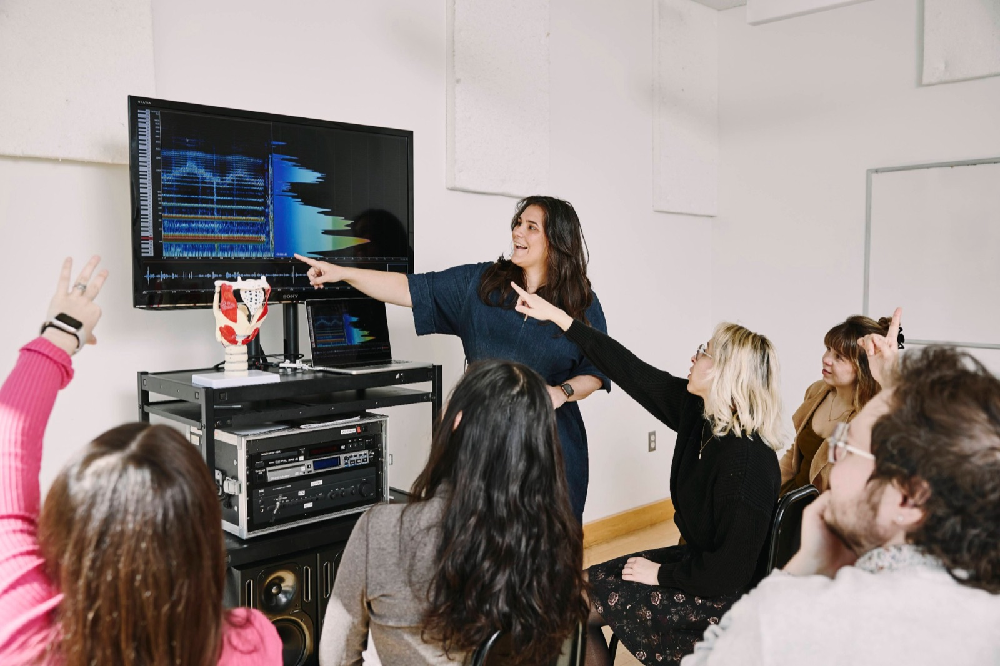
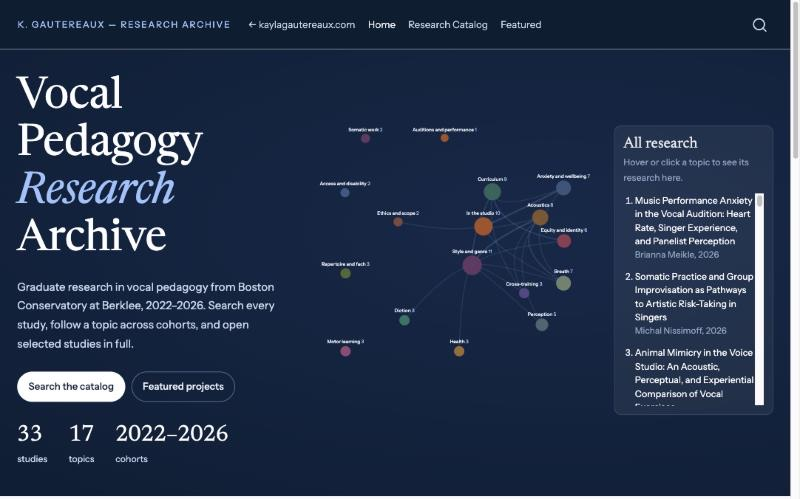
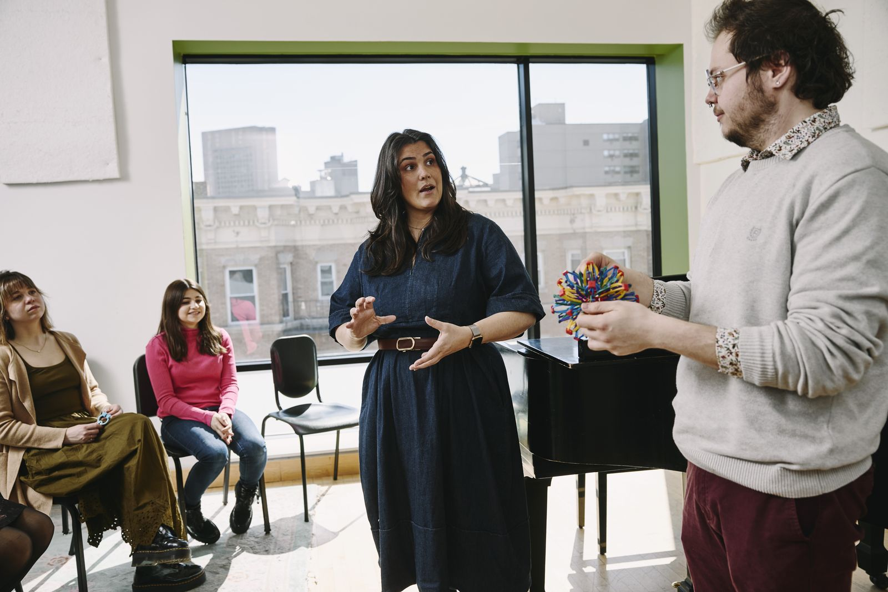
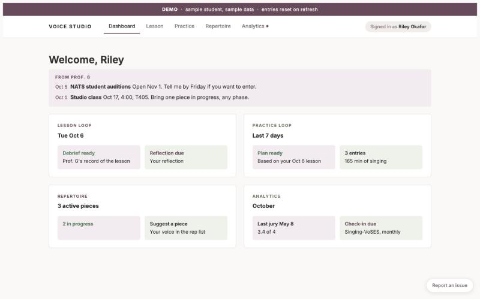
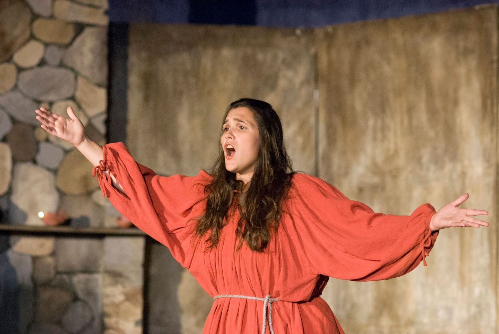

::: {.hero .hero-split .column-screen}

::: {.hero-text}

# Kayla Gautereaux

::: {.subtitle}
I teach voice and vocal pedagogy at Boston Conservatory at Berklee, where I lead the graduate vocal pedagogy area. I also build AI tools that support teaching and learning.
:::

[Research Archive](https://research.kaylagautereaux.com){.cta-button}
[Studio Portal demo](https://studio.kaylagautereaux.com/demo){.cta-button .secondary}

:::

::: {.hero-media}
{fig-alt="Kayla Gautereaux pointing to a spectrogram on a screen while graduate students raise their hands"}
[Photo: Simon Simard for Berklee]{.photo-credit .on-image}
:::

:::

::: {.split .column-screen}

::: {.split-text}
## Singing for health

In this episode of Berklee Office Hours, I talk about what singing does for our health and how to keep a voice healthy over a lifetime of use.

[More about me →](about.qmd)
:::

::: {.split-media}
::: {.video-embed}
<iframe src="https://www.youtube-nocookie.com/embed/H32-zdhTzq0?autoplay=1&mute=1&cc_load_policy=1&playsinline=1&rel=0" title="Berklee Office Hours: Singing for Health and Healthy Singing" allow="autoplay; encrypted-media; picture-in-picture; fullscreen" referrerpolicy="strict-origin-when-cross-origin" loading="eager" allowfullscreen></iframe>
:::

[Berklee Office Hours. Starts muted; click for sound.]{.video-caption}
:::

:::

::: {.stats-strip .column-screen}

::: {.stat}
[2026]{.stat-big}
[Best Microworkshop/<wbr>ToolTalk award, Pan American Vocology Association]{.stat-note}
:::

::: {.stat}
[2023]{.stat-big}
[Voice Pedagogy Award, National Association of Teachers of Singing]{.stat-note}
:::

::: {.stat}
[35]{.stat-big}
[conference presentations by program alumni since 2022]{.stat-note}
:::

::: {.stat}
[33]{.stat-big}
[graduate studies in the public research archive]{.stat-note}
:::

:::

::: {.split .reverse .column-screen}

::: {.split-text}
## Research

Since 2022 I have led research in Boston Conservatory's graduate vocal pedagogy degrees. Our students' theses are collected in a public archive of 33 studies, searchable by topic, with data you can explore yourself.

[Go to the research archive →](https://research.kaylagautereaux.com)
:::

::: {.split-media}
{.screenshot fig-alt="The research archive homepage, showing a network of research topics"}
:::

:::

::: {.split .column-screen}

::: {.split-text}
## Teaching

I lead the MM in Vocal Pedagogy and the MFA in Musical Theater Vocal Pedagogy. I also direct two programs open to the public: a summer workshop for working voice teachers, and Vocal Academy, where adult singers take lessons with our graduate students.

[Teaching →](teaching.qmd)
[Summer workshop →](https://bostonconservatory.berklee.edu/extension-programs/vocal-pedagogy-professional-workshop)
[Vocal Academy →](https://bostonconservatory.berklee.edu/extension-programs/vocal-academy)
:::

::: {.split-media}
{fig-alt="Kayla Gautereaux teaching a vocal pedagogy class while a singer holds an expanding sphere toy used to show breathing"}
[Photo: Simon Simard for Berklee]{.photo-credit}
:::

:::

::: {.split .reverse .column-screen}

::: {.split-text}
## AI and learning

I use AI as a partner in teaching and learning, not as a replacement for either. My private voice students use the AI Supported Voice Studio Portal, which I built, and it won the Pan American Vocology Association's 2026 Best Microworkshop/ToolTalk award.

[AI and learning →](ai-learning.qmd)
[Try the demo →](https://studio.kaylagautereaux.com/demo)
[Private studio →](https://studio.kaylagautereaux.com)
:::

::: {.split-media}
{.screenshot fig-alt="The studio portal demo dashboard with sample student data"}
:::

:::

::: {.photo-band .column-screen}
{fig-alt="Kayla Gautereaux as the Mother in Menotti's Amahl and the Night Visitors, singing with arms outstretched"}

::: {.band-text}
[As the Mother in Menotti's *Amahl and the Night Visitors*]{.band-caption}

[More about me →](about.qmd)
:::

:::
