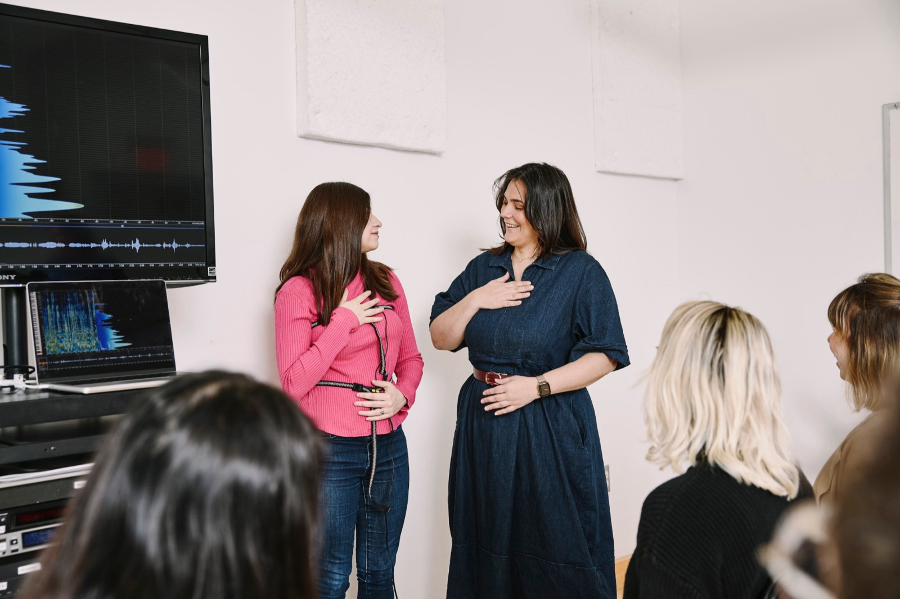
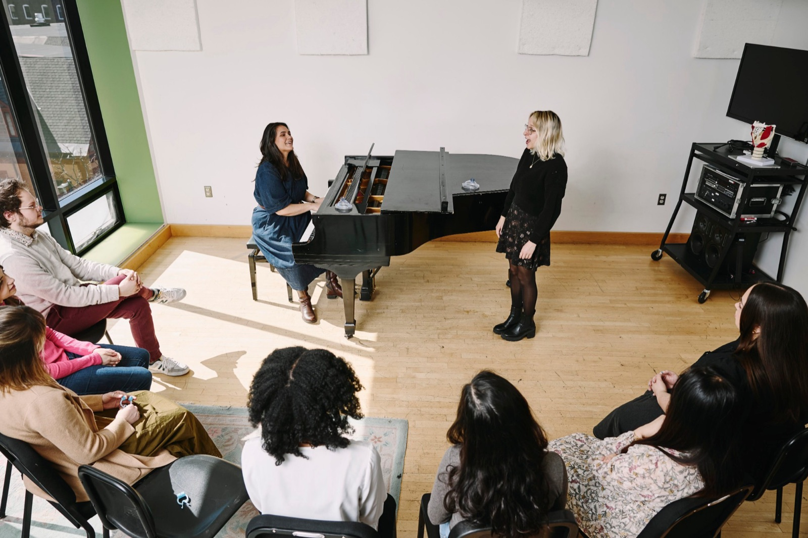
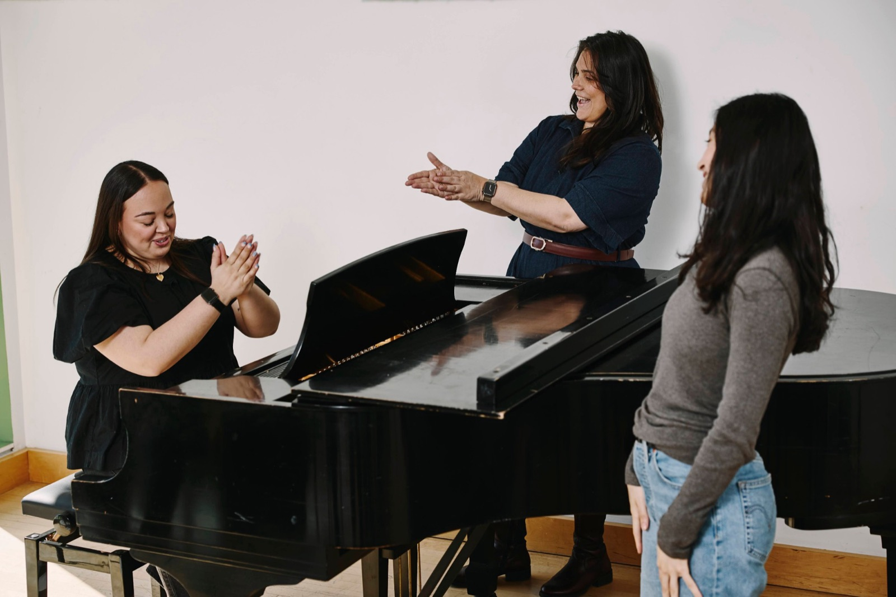
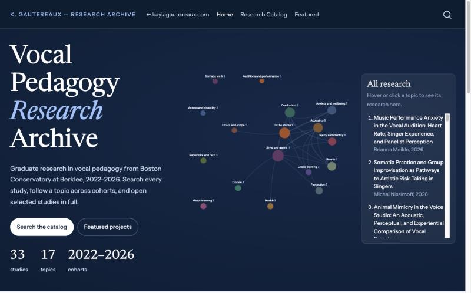
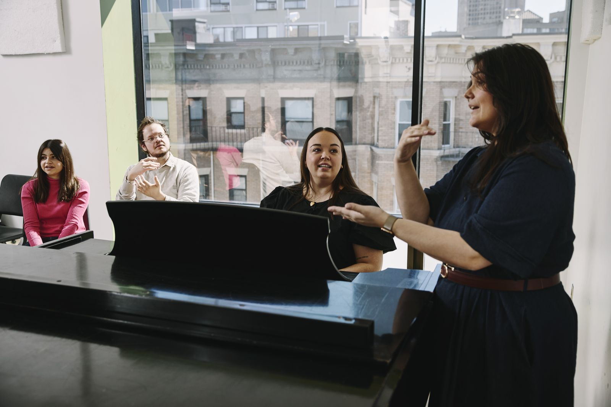
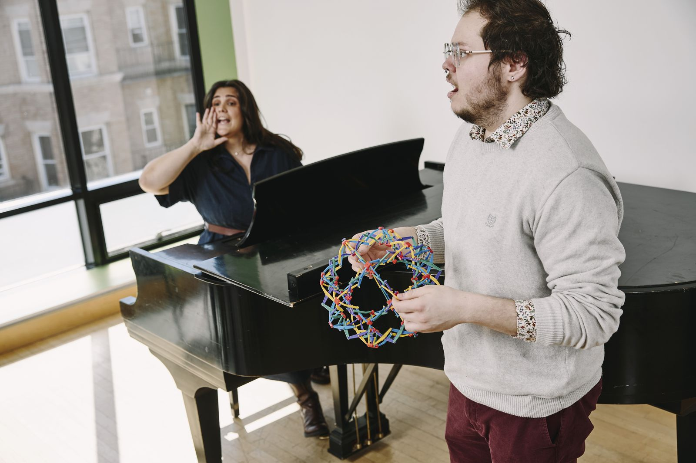

::: {.content-section}

{.lab-photo fig-alt="Kayla Gautereaux and a student wearing respiration bands, hands on chest and abdomen, in front of a spectrogram display"}
[Photo: Simon Simard for Berklee]{.photo-credit}

I lead two graduate degrees at Boston Conservatory at Berklee. The MM in Vocal Pedagogy is a 36-credit degree for singers who want to learn the science and craft of voice teaching, with pedagogy training in classical, musical theater, and contemporary styles. The MFA in Musical Theater Vocal Pedagogy is a 60-credit terminal degree for teachers who specialize in musical theater, and it includes an original thesis.

[Program details and how to apply](https://bostonconservatory.berklee.edu/vocal-pedagogy){.cta-button}

## How students move through the program

### Arriving

Incoming voice students receive a voice screening at the MGH Voice Center at Massachusetts General Hospital, and those with findings receive physician follow-up. The partnership with MGH predates my time here, and I have worked to strengthen it.

### Every week

{.lab-photo fig-alt="Kayla Gautereaux at the piano while a graduate student sings for classmates seated around the room"}
[Photo: Simon Simard for Berklee]{.photo-credit}

The whole cohort meets each week in the Vocal Pedagogy Colloquium, which I created and co-teach with Emily Siar. Students bring video of their own teaching for the group to discuss, teach live in front of their classmates, and hear from guest teachers. Both degrees now require it.

### The teaching exam

{.lab-photo fig-alt="Kayla Gautereaux coaching a graduate student teacher at the piano while the singer looks on"}
[Photo: Simon Simard for Berklee]{.photo-credit}

At the end of the spring, students teach a fifteen-minute lesson and then talk through their choices with a panel of two faculty members. Emily Siar and I developed the [rubric](https://sites.google.com/berklee.edu/bcbvocalpedagogy/graduate-vocal-pedagogy/voice-teaching-comprehensive-rubric) for this exam, and we talked about it on the [Berklee VoiceCast](https://remix.berklee.edu/voicecast) in July 2026.

### Research

{.lab-photo .screenshot-frame fig-alt="The research archive homepage, showing a network of research topics"}

MFA students spend three semesters on an original thesis, from the first question through data collection, analysis, and defense. They work in our voice science lab, which has acoustic analysis in Praat, heart rate and respiration monitoring, and Python data pipelines, and every study goes through institutional review board (IRB) review. Since 2022, alumni of the program have given 35 conference presentations, including 19 at the Voice Foundation, 7 at the Pan American Vocology Association, and 6 at the National Association of Teachers of Singing (NATS). Their theses are collected in a public [research archive](https://research.kaylagautereaux.com).

### After graduation

Graduates teach at Oberlin Conservatory, Catholic University of America, Oklahoma State University, UMass Amherst, Brown University, and other schools. The program's website has profiles of our [alumni](https://sites.google.com/berklee.edu/bcbvocalpedagogy/graduate-vocal-pedagogy/alumni) and [current students](https://sites.google.com/berklee.edu/bcbvocalpedagogy/graduate-vocal-pedagogy/student-profiles).

<!-- Outcome stats from March 2026 (42 graduates, Classes of 2022 to 2025; 85% teaching; 65% at universities). Confirm current figures before restoring. -->

## Workshops for working teachers

{.lab-photo fig-alt="Kayla Gautereaux at the piano leading a group session"}
[Photo: Simon Simard for Berklee]{.photo-credit}

Each summer I direct the Vocal Pedagogy Professional Workshop (VPPW), four days for collegiate and private voice teachers and vocal and choral music educators working in classical, musical theater, and contemporary styles. You can join in person at Boston Conservatory or online. The program mixes lectures and master classes with mentored teaching in small afternoon cohorts. No audition is required.

[Skill up your studio teaching at VPPW](https://bostonconservatory.berklee.edu/extension-programs/vocal-pedagogy-professional-workshop){.cta-button}

Since 2019 I have also been on the faculty of the Acoustic Vocal Pedagogy Workshop, run by the Embodied Music Lab.

## Lessons with our graduate students

I also direct Vocal Academy, which pairs adult singers with the graduate students in our MM and MFA programs. Each semester includes ten one-hour private lessons in classical, musical theater, or contemporary singing, scheduled around your week. It is open to anyone 18 or older, with no audition.

[Study with our graduate student teachers](https://bostonconservatory.berklee.edu/extension-programs/vocal-academy){.cta-button}

## Private studio

{.lab-photo fig-alt="Kayla Gautereaux at the piano coaching a singer"}
[Photo: Simon Simard for Berklee]{.photo-credit}

I teach voice lessons and coach voice teachers privately, in person in the Boston area or online.

[Visit the studio site](https://studio.kaylagautereaux.com){.cta-button}

:::
